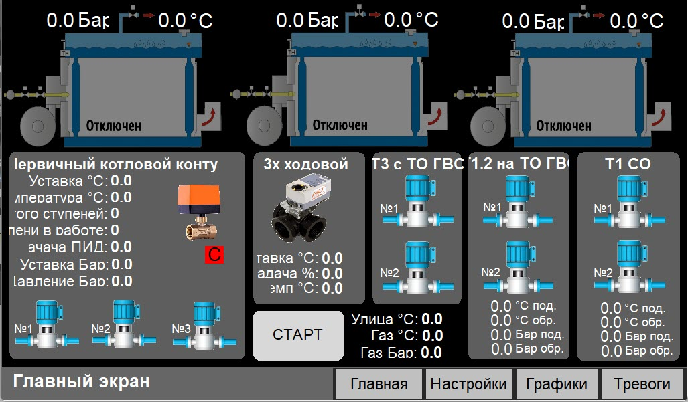
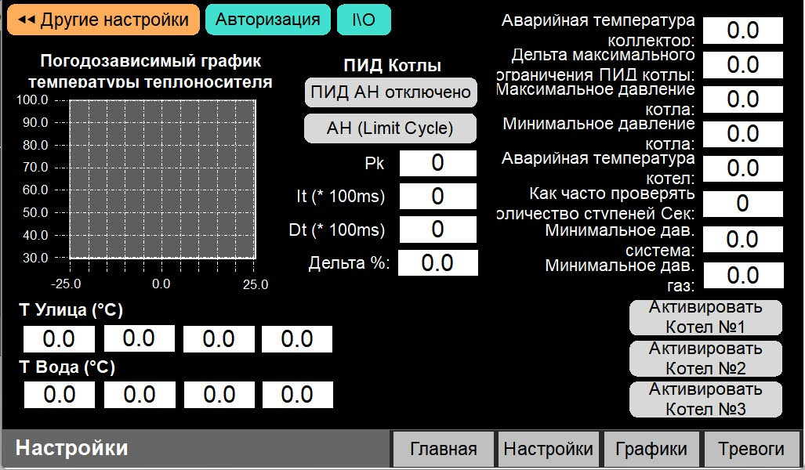
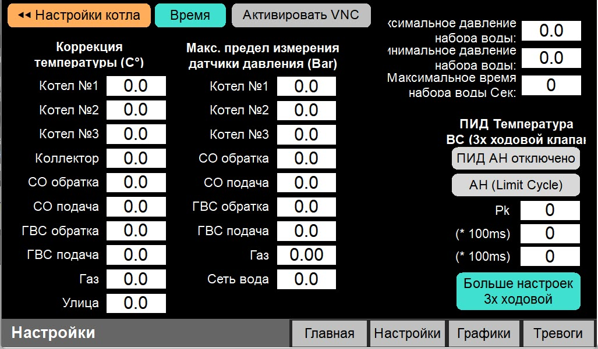

# Руководство пользователя. Котельная: каскад 3 котлов

Документ для оператора и наладчика. Описывает экраны панели оператора, каждую настройку, аварии и порядок работы.

Содержание:

1. [Как работает установка](#1-как-работает-установка)
2. [Главный экран](#2-главный-экран)
3. [Экран «Настройки»](#3-экран-настройки)
4. [Экран «Настройки котла»](#4-экран-настройки-котла)
5. [Окно «3х ходовой клапан»](#5-окно-3х-ходовой-клапан)
6. [Аварии и их сброс](#6-аварии-и-их-сброс)
7. [Уставки по умолчанию](#7-уставки-по-умолчанию)
8. [Первый пуск и проверки](#8-первый-пуск-и-проверки)
9. [Обслуживание: моточасы](#9-обслуживание-моточасы)
10. [Единицы измерения](#10-единицы-измерения)

---

## 1. Как работает установка

Три водогрейных котла работают в каскаде. У каждого котла две ступени мощности (горелка имеет две ступени), итого 6 ступеней. Контроллер сам решает, сколько ступеней держать включёнными.

Логика в двух словах:

- ПИД-регулятор каскада сравнивает температуру в первичном котловом контуре с заданием и выдаёт «задачу» 0…600 (это 0…100 % мощности).
- Задание температуры считается по погодозависимой кривой: чем холоднее на улице, тем горячее вода в подаче.
- Контроллер переводит задачу в количество ступеней (600 = все 6) и раз в `Как часто проверять` секунд добавляет или убирает ступени.
- **Добавление** — не больше одной ступени за проверку, и только если ПИД вышел за границу следующей ступени на величину «Дельта %». Так мощность растёт плавно, без дребезга на границе.
- **Убавление** — сразу на столько ступеней, сколько требует ПИД, без задержек: перегрев опасен.
- Котлы включаются по очереди и меняются местами (ротация), чтобы износ был равномерным. Ступени распределяются по кругу, чтобы первым всегда не работал один и тот же котёл.
- Насосы контуров Т1 (СО), Т1.2 и Т3 (ТО ГВС) и насосы малого контура включаются по своей логике от числа активных ступеней; есть ручной режим и контроль подтверждения работы (нет сигнала 2 с — авария).
- 3-ходовой клапан держит температуру на выходе теплообменника ГВС своим ПИД-регулятором.
- Подпитка включает клапан набора воды по давлению в системе и контролирует время набора.

---

## 2. Главный экран

### 2.1. Котлы (верхняя часть)

Для каждого котла слева направо:

| Поле | Что показывает |
|---|---|
| `0.0 Баp` | Давление в котле по датчику. В норме между «Минимальное давление котла» и «Максимальное давление котла» |
| `0.0 °C` | Температура котла. Не должна доходить до «Аварийная температура котёл» |
| `Отключен` | Состояние котла: `Отключен` — котёл не активирован или нет задания; `Работает` / ступень — котёл в работе |
| Иконка горелки | Пламя — горелка работает, есть ступень |

### 2.2. Блок «Первичный котловой контур»

| Поле | Что показывает |
|---|---|
| `Уставка °C` | Задание температуры теплоносителя — то, что посчитано по погодозависимой кривой с учётом температуры улицы |
| `Температура °C` | Фактическая температура в первичном контуре (обратка с коллектора) |
| `Всего ступеней` | Сколько ступеней доступно автоматике: по 2 на каждый активированный котёл без аварий (0…6) |
| `В работе` | Сколько ступеней включено сейчас |
| `Задача ПИД` | Выход ПИД-регулятора каскада, 0…600. 600 = нужны все 6 ступеней |
| `Уставка Баp` | Заданное давление подпитки (порог, при котором подпитка прекращается) |
| `Давление Баp` | Фактическое давление в системе (по датчику подпитки) |

Если `Всего ступеней` = 0 — автоматика работать не будет: все котлы в ручном, в аварии или не активированы. Это авария 29 «Нет доступных ступеней горения».

### 2.3. Блок «3х ходовой»

| Поле | Что показывает |
|---|---|
| `Уставка °C` | Задание температуры ГВС после теплообменника |
| `Задача %` | Положение клапана, которое требует ПИД: 0.0 % — закрыт, 100.0 % — открыт |
| `Темп °C` | Фактическая температура после теплообменника |

### 2.4. Блоки насосов

`Т3 с ТО ГВС`, `1.2 на ТО ГВС`, `Т1 СО` — по два насоса в каждом контуре (№1 и №2). Иконка насоса вращается/подсвечена — насос работает. Ниже для каждого контура показаны:

- `°C под.` — температура подачи контура,
- `°C обр.` — температура обратки контура,
- `Баp под.` — давление подачи,
- `Баp обр.` — давление обратки.

### 2.5. Блок насосов малого контура

`№1`, `№2`, `№3` — циркуляционные насосы малого котлового контура. Работают при наличии активных ступеней, есть ротация.

### 2.6. Кнопки и индикаторы

| Элемент | Назначение |
|---|---|
| `СТАРТ` | Пуск/останов каскада. При остановке ступени снимаются, котлы гаснут, насосы продолжают работать по своей логике |
| Красный круг с лампой | Индикатор аварии: горит, пока есть хотя бы одна авария |
| `Улица °C` | Температура наружного воздуха (по ней выбирается задание) |
| `Газ °C`, `Газ Баp` | Температура и давление газа |
| Нижнее меню | `Главная`, `Настройки`, `Графики`, `Тревоги` |

---

## 3. Экран «Настройки»

Кнопки в верхней строке: `◀◀ Другие настройки` (экран «Настройки котла»), `Авторизация` (вход по паролю), `ИО` (диагностика входов/выходов).

### 3.1. Погодозависимый график

График задания температуры теплоносителя от температуры улицы, построен по четырём точкам кривой. Ось X — температура улицы, ось Y — температура подачи.

| Поле | Что задаёт |
|---|---|
| `Т Улица (°C)` — 4 поля | Температура улицы в точках 1…4. По умолчанию −15 / −5 / +5 / +15 |
| `Т Вода (°C)` — 4 поля | Температура подачи в этих точках. По умолчанию 78 / 68 / 58 / 48 |

Требования: температуры улицы должны возрастать слева направо, температуры воды — убывать (на улице теплее → подача холоднее). Если на улице теплее последней точки, берётся последняя точка. Значение 0 в любой точке означает «не введена» → авария 30 «Не все важные настройки заполнены» и блокировка каскада, поэтому нули в кривой недопустимы.

> Порядок точек задаётся один раз при наладке. «Дёргать» кривую во время работы не нужно: правится только `Т Вода` в точках, чтобы подстроить комфорт.

### 3.2. Блок «ПИД Котлы»

Регулятор каскада.

| Поле | Что задаёт |
|---|---|
| `ПИД АН открычено` / `ПИД АН` | Кнопка автонастройки ПИД (обычный режим). На время автонастройки регулятор сам раскачивает процесс и считает коэффициенты. В обычной работе кнопка должна быть **отключена** |
| `АН (Limit Cycle)` | Автонастройка методом предельного цикла (релейная). Применяется, когда обычная автонастройка не сходится |
| `Рк` | Пропорциональный коэффициент Kp. Больше — регулятор жёстче реагирует на отклонение |
| `It (*100ms)` | Время интегрирования Ti в единицах по 100 мс: 100 = 10 с. Больше — медленнее убирается статическая ошибка |
| `Dt (*100ms)` | Время дифференцирования Td в единицах по 100 мс: 100 = 10 с. Больше — сильнее реакция на скорость изменения температуры |
| `Дельта %` | **Зона нечувствительности добавления ступени.** Ступень добавляется не на самой границе, а когда ПИД перешагнул её на эту величину — иначе на границе ступень включалась бы и отключалась каждый период. Задаётся просто в процентах с точностью 0.1 %: `5.0` значит 5.0 % от полной мощности. Контроллер сам пересчитывает проценты в свою внутреннюю шкалу 0…600 (5.0 % → 30 единиц), оператору об этом думать не нужно. По умолчанию 5.0 % |

> Коэффициенты ПИД (Рк, It, Dt) задаются **только с панели** и в контроллере не инициализируются — их значения подбираются при наладке и должны быть внесены в протокол. Если `Рк = 0`, каскад блокируется аварией 30.
>
> Период дискретизации ПИД — 1 секунда, поэтому Ti и Td должны быть заметно больше 1 с (то есть `It`/`Dt` — сотни единиц, а не единицы). После смены периода дискретизации коэффициенты нужно пересчитать.

### 3.3. Ограничения и режимы (правая колонка)

| Поле | Что задаёт | По умолчанию |
|---|---|---|
| `Аварийная температура коллектор` | Температура коллектора, выше которой — авария 32 и ПИД каскада снимается | 95 °C |
| `Дельта максимального ограничения ПИД котлы` | На сколько градусов температура может превысить задание, прежде чем ПИД полностью снимется (защита от перегрева). Больше — мягче | 5 °C |
| `Максимальное давление котла` | Верхний порог давления в котле, авария 1/6/11 | 4.0 бар |
| `Минимальное давление котла` | Нижний порог давления в котле, авария 2/7/12. На 0.0 бар не действует — там авария обрыва датчика 46/47/48 | 1.0 бар |
| `Аварийная температура котёл` | Температура котла, выше которой — авария перегрева 0/5/10 | 90 °C |
| `Как часто проверять количество ступеней Сек` | Период, с которым контроллер добавляет или убирает ступень. Меньше — система «острее», больше — плавнее и экономнее по ресурсу горелок. Рекомендуется 20…60 с | 30 с |
| `Минимальное давление система` | Ниже этого давления в системе — авария 25 и запрет циркуляционных насосов (защита от сухого хода). На 0.0 бар не действует: это признак оборванного датчика (авария 49), насосы при этом работают | 2.0 бар |
| `Минимальное давление газ` | Ниже — авария 24 и блокировка каскада | 3.0 бар (проверить по датчику) |

### 3.4. Кнопки активации котлов

| Кнопка | Назначение |
|---|---|
| `Активировать Котел №1` / `№2` / `№3` | Разрешает участие котла в каскаде. Если котёл не активирован, автоматика его не включает — он может работать только вручную |

Обычно активированы все три котла. Котёл выводят из каскада на время ремонта или обслуживания.

---

## 4. Экран «Настройки котла»

Кнопки верхней строки: `◀◀ Настройки котла` (назад), `Время` (системные часы и дата панели), `Активировать VNC` (удалённый доступ к экрану панели).

### 4.1. Коррекция температуры (°C)

| Поле | Что задаёт |
|---|---|
| `Котел №1`, `№2`, `№3` | Поправка к показанию датчика температуры котла, °C (с точностью 0.1) |
| `Коллектор` | Поправка датчика температуры коллектора (обратка первичного контура) |
| `СО обратка` | Поправка датчика обратки системы отопления |
| `СО подача` | Поправка датчика подачи системы отопления |
| `ГВС обратка` | Поправка датчика обратки теплообменника ГВС |
| `ГВС подача` | Поправка датчика подачи теплообменника ГВС |
| `Газ` | Поправка датчика температуры газа |
| `Улица` | Поправка датчика наружной температуры |

Поправка прибавляется к измеренному значению. Нужна, чтобы показания на панели совпадали с эталонным термометром (например, +0.5 °C при занижении).

### 4.2. Макс. предел измерения датчиков давления (Bar)

Шкала каждого датчика давления. Ставится по паспорту датчика: если датчик 0…16 бар — вводится 16.0. По этой шкале контроллер пересчитывает ток 4…20 мА в давление.

| Поле | Датчик |
|---|---|
| `Котел №1`, `№2`, `№3` | Давление в котле |
| `СО обратка`, `СО подача` | Давление обратки/подачи отопления |
| `ГВС обратка`, `ГВС подача` | Давление обратки/подачи теплообменника |
| `Газ` | Давление газа |
| `Сеть вода` | Давление в системе (подпитка) |

Ноль — «не задан»: без шкалы давление считается неверно.

### 4.3. Подпитка (набор воды, правая колонка)

| Поле | Что задаёт | По умолчанию |
|---|---|---|
| `Максимальное давление набора воды` | Давление в системе, при котором подпитка **прекращается** | 2.5 бар |
| `Минимальное давление набора воды` | Давление в системе, при котором подпитка **начинается** | 1.5 бар |
| `Максимальное время набора воды Сек` | Сколько секунд может длиться непрерывный набор. Дольше — авария 34 (клапан или утечка) | 300 с |

Между началом и остановкой обязательно должен быть зазор (гистерезис), иначе клапан будет «дребезжать». Пример: начало 1.5 бар, стоп 2.5 бар.

### 4.4. Блок «ПИД Температура ВС (3х ходовой клапан)»

Регулятор 3-ходового клапана ГВС. Поля те же, что у ПИД котлов: `ПИД АН`, `АН (Limit Cycle)`, `Рк`, `(* 100ms)` — Ti, `(* 100ms)` — Td.

Кнопка `Больше настроек 3х ходовой` открывает окно настроек клапана (раздел 5).

---

## 5. Окно «3х ходовой клапан»

Слева — режим и настройки ПИД, справа — рабочие параметры клапана. Закрытие — крестиком в правом верхнем углу.

### 5.1. Режимы

| Кнопка | Назначение |
|---|---|
| `ОТКЛЮЧЕН` | Клапан не регулирует; дополнительно действует галочка «Не закрывать при отключении» |
| `РУЧНОЙ` | Клапан держит положение, заданное в `Положение в ручном %` |

### 5.2. Настройки ПИД

`ПИД АН`, `АН (Limit Cycle)`, `Рк`, `It (* 100ms)`, `Dt (* 100ms)` — как в разделе 3.2, но для контура ГВС.

### 5.3. Рабочие параметры

| Поле | Что задаёт | По умолчанию |
|---|---|---|
| `Положение в ручном %` | Положение клапана в ручном режиме: 0.0 % — закрыт, 100.0 % — открыт | 50.0 % |
| `Не закрывать при отключении` | Если включено, при отключении клапан остаётся в текущем положении (чтобы не заморозить теплообменник) | — |
| `Уставка °C` | Температура ГВС, которую держит регулятор | 60 °C |
| `Дельта лимит ПИД °C` | Зона нечувствительности по температуре: ПИД работает, пока температура ниже уставки на эту величину. Внутри зоны клапан не двигается | 0.5 °C |
| `Время хода Сек` | Полное время хода клапана от «закрыт» до «открыт» по паспорту (обычно 60…120 с) | 120 с (проверить по паспорту) |
| `Время люфт мс` | Мёртвый ход привода в миллисекундах. Компенсируется при реверсе, чтобы клапан точно отрабатывал малые перемещения | 500 мс |
| `Зона не чувствительности %` | Зона нечувствительности положения: если новое задание отличается от текущего меньше, чем на эту величину, клапан не двигается. Защищает привод от постоянного дёргания | 5.0 % |
| `Максимальная температура °C` | Выше — авария 35 «Превышена температура в контуре 3х ходового клапана» | 75 °C |

> В ручном режиме зона нечувствительности принудительно равна нулю: клапан точно становится в заданное положение.

---

## 6. Аварии и их сброс

Экран `Тревоги` показывает активные аварии с текстом и временем. Есть звуковая сирена (Y007) и лампа аварии (Y010).

**Сброс аварий:** кнопка на панели (или кнопка `Сброс сигнализации` на шкафу, X030). Сирена снимается этой же кнопкой. Защёлкнутые аварии (перегрев, авария горелки, термозащита, насосы, ЭКМ) после сброса уйдут только если причина устранена.

### 6.1. Список аварий

| № | Текст на панели | Что делать | Блокирует каскад |
|---|---|---|---|
| 0 / 5 / 10 | Перегрев котла №1 / №2 / №3 | Проверить температуру, циркуляцию, датчик. Котёл отключается по своей уставке | — |
| 1 / 6 / 11 | Давление в котле №1 / №2 / №3 превышено | Проверить давление, расширительный бак, датчик | — |
| 2 / 7 / 12 | Давление в котле №1 / №2 / №3 низкое | Проверить подпитку, утечки, датчик | — |
| 3 / 8 / 13 | Горелка №1 / №2 / №3 тревога | Авария от горелки (её собственный контроллер). Смотреть код на горелке | — |
| 4 / 9 / 14 | Термозащита котла №1 / №2 / №3 | Пропал контакт термозащиты (X035 / X036 / X037). Котёл аварийно опасен — проверить датчик-реле температуры | — |
| 15…23 | Насос №1/№2 контуров Т1, Т1.2, Т3 и циркуляция №1/№2/№3 | Нет подтверждения работы насоса 2 с: проверить автомат, пускатель, сигнальный контакт | — |
| 24 | Давление газа слишком низкое | Проверить давление газа перед горелками, фильтр, датчик. Каскад блокируется | **да** |
| 25 | Давление в системе слишком низкое | Нет воды в системе: проверить подпитку и утечки. Насосы запрещены | — |
| 26 | Сработал ЭКМ | Реле максимального давления разомкнуто. Проверить давление в системе | **да** |
| 27 | Кнопка аварийного отключения | Нажата аварийная кнопка (X001). Восстановить и сбросить | **да** |
| 28 | Сработало реле контроля фаз | Проверить питание, фазы, чередование | **да** |
| 29 | Нет доступных ступеней горения | Все котлы в ручном/аварии/не активированы. Проверить активацию котлов и аварии | **да** |
| 30 | Не все важные настройки заполнены | Введены нули в критичных уставках или `Рк = 0`. Открыть «Настройки» и заполнить | **да** |
| 31 | Запущено горение, нет циркуляции | Каскад пущен, но ни один насос не работает. Проверить насосы и их разрешение | **да** |
| 32 | Аварийная температура обратки | Температура коллектора выше уставки: ПИД снимается, ступени убираются. Проверить циркуляцию | — |
| 33 | Аварийное давление в коллекторе | Давление в системе выше уставки — подпитка запрещена | — |
| 34 | Клапан набора воды превышение время работы | Подпитка не набрала давление за отведённое время: проверить клапан, утечку | — |
| 35 | Первышена температура в контуре 3х ходового клапана | Температура ГВС выше максимальной: проверить клапан и датчик | — |
| 36 / 37 / 38 | Обрыв датчика температуры котла №1 / №2 / №3 | Датчик показывает -199 °C (обрыв Pt100 или потеря связи с модулем). Котёл выводится из каскада до устранения | **котёл** |
| 39 | Обрыв датчика температуры коллектора | Нет обратной связи ПИД каскада: задание обнуляется, ступени снимаются. Проверить датчик и линию | — |
| 40 | Обрыв датчика температуры обратки отопления | Датчик не влияет на работу автоматики, но показание на панели недостоверно. Проверить датчик | — |
| 41 | Обрыв датчика температуры подачи отопления | Датчик не влияет на работу автоматики. Проверить датчик | — |
| 42 | Обрыв датчика температуры подачи на теплообменник ГВС | Датчик не влияет на работу автоматики. Проверить датчик | — |
| 43 | Обрыв датчика температуры обратки с теплообменника ГВС | Нет обратной связи ПИД 3-ходового клапана: регулятор снимается, клапан закрывается (в авто). Проверить датчик | — |
| 44 | Обрыв датчика температуры газа | Датчик не влияет на работу автоматики. Проверить датчик | — |
| 45 | Обрыв датчика температуры наружного воздуха | Погодозависимая кривая считает по -199 °C, то есть по самой холодной точке (максимальная подача). Проверить датчик | — |
| 46 / 47 / 48 | Давление котла №1 / №2 / №3 равно 0.0 бар (вероятно обрыв датчика) | Датчик давления показывает 0.0 бар: обрыв линии 4..20 мА или отказ датчика. Котёл выводится из каскада до устранения, остальные работают | **котёл** |
| 49 | Давление в системе 0.0 бар (вероятно обрыв датчика) | Обрыв линии или отказ датчика давления подпитки. Подпитка запрещена (клапан закрыт), **насосы продолжают работать** | — |
| 50 | Давление газа 0.0 бар (вероятно обрыв датчика) | Обрыв линии или отказ датчика давления газа. Каскад останавливает авария 24 («давление газа слишком низкое»), показываются обе тревоги | — |
| 51 | Давление подачи отопления 0.0 бар (вероятно обрыв датчика) | Датчик не влияет на работу автоматики. Проверить датчик | — |
| 52 | Давление обратки отопления 0.0 бар (вероятно обрыв датчика) | Датчик не влияет на работу автоматики. Проверить датчик | — |
| 53 | Давление подачи ГВС 0.0 бар (вероятно обрыв датчика) | Датчик не влияет на работу автоматики. Проверить датчик | — |
| 54 | Давление обратки ГВС 0.0 бар (вероятно обрыв датчика) | Датчик не влияет на работу автоматики. Проверить датчик | — |

> Обрыв датчика температуры определяется по точному значению -199.0 °C: ровно столько модуль отдаёт на разомкнутом Pt100. По датчикам котлов и по остальным датчикам задержка 2 с; по датчикам, на которых работает регулирование (39 — коллектор, 43 — обратка ТО ГВС), задержки нет, регулятор снимается сразу. Датчики, которые не участвуют в регулировании (40, 41, 42, 44, 45), выдаются только как тревога и работу каскада не меняют.

> Нулевое давление определяется по точному значению 0 отсчётов АЦП: на разомкнутой линии 4..20 мА модуль отдаёт ровно 0, то есть 0.0 бар. Показание 1 отсчёт и выше считается живым датчиком, поэтому шум линии тревогу не даёт. Отличить обрыв провода от настоящего нуля прибором нельзя, поэтому в тексте тревоги стоит «вероятно обрыв». Проверять нужно в первую очередь линию и разъём датчика.

> Важно: обрыв датчика давления **не останавливает насосы и не запрещает подпитку как таковую** — клапан подпитки просто закрыт, чтобы не залить систему по неработающему датчику. Запрет насосов по низкому давлению (авария 25) действует только при живом датчике, то есть при показании больше 0 отсчётов.

> Тексты опечаток в панели исправлены в `ALARMS_HMI.xls` («Клапан набора воды: превышено время работы», «Превышена температура в контуре 3х ходового клапана»).

### 6.2. Общий порядок действий при аварии

1. Прочитать текст на экране `Тревоги`.
2. Устранить причину (давление, температура, горелка, питание).
3. Нажать сброс аварий. Если авария возвращается — причина не устранена, не «сбрасывать до бесконечности», а искать неисправность.
4. Если каскад заблокирован (аварии 24, 26…31) — после сброса нажать `СТАРТ` на главном экране.

---

## 7. Уставки по умолчанию

Значения записываются в контроллер только если уставка равна нулю (то есть при первом пуске или после сброса памяти). Введённые оператором значения не перезаписываются.

| Параметр | По умолчанию | Адрес |
|---|---|---|
| Как часто проверять количество ступеней | 30 с | D513 |
| Дельта % (зона нечувствительности каскада) | 5.0 % | D583 |
| Аварийная температура котёл | 90 °C | D511 |
| Аварийная температура коллектора | 95 °C | D528 |
| Дельта максимального ограничения ПИД | 5 °C | D512 |
| Максимальное давление котла | 4.0 бар | D514 |
| Минимальное давление котла | 1.0 бар | D515 |
| Минимальное давление система | 2.0 бар | D519 |
| Набор воды: начало / стоп | 1.5 / 2.5 бар | D516 / D517 |
| Максимальное время набора воды | 300 с | D520 |
| Минимальное давление газ | 3.0 бар | D518 |
| Кривая: улица | −15 / −5 / +5 / +15 °C | D530, D532, D534, D536 |
| Кривая: подача | 78 / 68 / 58 / 48 °C | D531, D533, D535, D537 |
| 3-ходовой: уставка ГВС | 60 °C | D510 |
| 3-ходовой: дельта лимит ПИД | 0.5 °C | D525 |
| 3-ходовой: максимальная температура | 75 °C | D527 |
| 3-ходовой: зона нечувствительности | 5.0 % | D522 |
| 3-ходовой: время хода / люфт | 120 с / 500 мс | D523 / D524 |
| 3-ходовой: положение в ручном | 50.0 % | D526 |
| Пределы датчиков давления | 16.0 бар | D550…D558 |

Значения по умолчанию — ориентировочные. Перед сдачей объекта их нужно проверить по проекту котельной и паспортам оборудования.

---

## 8. Первый пуск и проверки

1. Проверить шкалы датчиков давления (`Макс. предел измерения`) — без них давление считается неверно.
2. Проверить коррекции температур по эталонному термометру.
3. Ввести кривую погодозависимости под объект.
4. Активировать котлы, которые участвуют в каскаде.
5. Проверить по одному: горелки (ступень 1, ступень 2), насосы всех контуров, 3-ходовой клапан (полный ход и люфт), клапан подпитки.
6. Проверить аварийные входы: ЭКМ, аварийная кнопка, РКФ, термозащита котлов, аварии горелок, подтверждение насосов.
7. Подобрать коэффициенты ПИД каскада и 3-ходового клапана (кнопки `ПИД АН` / `АН (Limit Cycle)`), результаты записать в протокол.
8. Проверить каскад: плавность добавления ступеней (не больше одной за период), быстроту убавления, отсутствие дребезга на границе ступени (подстройка «Дельта %»).
9. Проверить подпитку и её тайм-аут.
10. Сверить показания и аварии на панели с фактическим состоянием.

---

## 9. Обслуживание: моточасы

Контроллер считает наработку каждого котла и каждого насоса (часы работы). Счётчики хранятся в памяти и не сбрасываются при выключении питания.

- Наработка котла — по работе горелки; при переполнении счётчика поднимается флаг, его надо сбросить после записи в журнал.
- Сброс моточасов — отдельными командами по каждому котлу и насосу (с панели).
- Моточасы — основание для планового обслуживания (горелки, насосы, чистка теплообменников).

---

## 10. Единицы измерения

Панель показывает привычные единицы, контроллер внутри хранит целые числа:

| Величина | На панели | В контроллере |
|---|---|---|
| Температура | °C с одним знаком (12.5 °C) | °C × 10 (125) |
| Давление | бар с одним знаком (2.5 бар) | бар × 10 (25) |
| Проценты (положение клапана, «Дельта %») | % с одним знаком (5.0 %) | % × 10 (50) |
| Выход ПИД | — | 0…600 = 0…100 %, 1 % = 6 единиц |
| Время (уставки) | секунды | секунды |
| Время люфта клапана | миллисекунды | миллисекунды |

Значит: если в этом руководстве сказано «5.0 %», на панели вводится `5.0`, а в контроллере это число 50.
